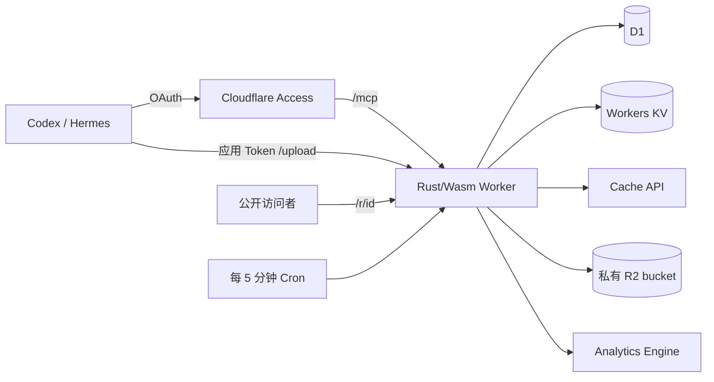

# cf-content-share 首版技术设计

- 状态：正式工程已实现短链、文件与容量恢复、统计、资源初始化和 Agent Skill；本轮增加资源有效期、一次性激活与 KV 24 小时兜底。本轮功能已部署并激活，完整本地回归及本轮云端验收已完成；证据边界见[实现进度](../plan/implementation.md)。
- 更新日期：2026-10-12。
- 需求基线：[产品需求](../requirements/product.md)。

本次变更状态：2026-10-12 代码、0003 Schema、激活脚本与上传 Skill 已实现下述有效期契约。Schema 迁移不会启动旧资源倒计时，须在兼容 Worker 发布后显式激活；本次实际 T0 为2026-10-12 02:29:02 UTC，结果及边界见[有效期云端验收](../research/2026-10-12-expiration-cloud-acceptance.md)。旧版本云端验收不能替代本次证据。

本文描述首版实现契约；部署与实际验收范围见[正式服务云端验收](../research/2026-10-11-formal-cloud-acceptance.md)。当前落地范围见[正式服务实现进度](../plan/implementation.md)，文件恢复细节见[文件与恢复](../files.md)，可执行部署步骤见[部署与升级](../deployment.md)。已退役原型的[历史验证证据](../research/2026-10-11-rust-wasm-compatibility.md)单独记录，原型代码和环境已删除。operation 名称、字段和存储布局是据已确认规则拟定的实现契约；正式 Schema、迁移及 `describe` 输出必须与本文对齐。Rust/MCP/OAuth 或平台能力验证失败时，先说明差异，不静默更换技术栈或降低需求。

## 1. 范围与技术取舍

服务面向单人自部署，通过 Agent 管理网址、图片和文件。保留简单搜索、元数据编辑、访问统计和未完成操作恢复，新增默认 30 天的资源有效期及到期清理；不提供管理 GUI、多用户协作、文件覆盖、回收站、到期／删除恢复、远程 URL 文件导入或断点续传。

| 决策 | 选择与理由 | 已接受的代价 |
| --- | --- | --- |
| 运行环境 | Rust/Wasm + workers-rs，单 Worker | MCP 传输、OAuth 验证及流式接口需要实测；不承诺比 TypeScript 更快或更便宜 |
| 管理数据与公开映射 | D1 为权威数据，KV 缓存公开读取所需字段 | 增加 KV 同步与失效处理；删除和目标修改允许最终一致性 |
| KV 一致性与回源 | 主动同步最新状态、删除标记、24 小时绝对失效兜底；沿用现有 D1 任务与 Cron | 减少正常读取回源；异常情况下，已提交删除的服务端访问窗口最多仍可持续 24 小时，不承诺立即失效 |
| 资源生命周期 | 新资源首次发布后默认 30 天，可改期限或永久；旧的未删除资源统一在 T0 后保留 30 天 | 旧数据需一次性迁移；到期不能恢复，文件清理异步执行 |
| 文件传输 | Worker 流式中转 R2 | 受 Cloudflare 入站请求限制；占用 Worker 执行资源，失败需要重传 |
| 管理认证 | Access Managed OAuth + Cloudflare 身份提供方 | 接受 Beta 能力；客户端与路径配置有联调依赖 |
| 上传认证 | 自有应用级 Token，固定 24 小时 | OAuth 撤销与应用 Token 撤销独立，不能假定同步失效 |
| MCP 入口 | `describe` + `invoke` | Agent 首次调用某项能力可能多一次参数发现；服务端负责具体参数校验 |
| 文件缓存 | 浏览器一年缓存，边缘文件缓存与资源状态分开 | 删除不能收回浏览器已有副本；本地命中没有统计事件 |
| 失败恢复 | D1 操作记录 + 5 分钟 Cron | 空闲时仍有轻量查询，换取较少组件和调度状态 |

不引入 Durable Objects Alarm、Queues、Code Mode 代码执行沙箱或图片转换服务。普通管理编辑按单人操作处理，以最后一次成功写入为准，不提供 `expected_version` 等协作冲突协议。上传幂等、容量预留和后台任务的内部防重复处理仍然必要。

### D1 数据访问边界

服务使用 D1 原生 binding，不引入 ORM。`src/store/` 中的 `models.rs` 定义资源、操作记录和有限状态枚举；序列化保持现有数据库与 API 的字符串取值。`resources.rs`、`operations.rs`、`uploads.rs` 和 `sessions.rs` 封装各自的查询、绑定和持久化动作。列表过滤复用已有资源／操作查询路径，统计模块的 D1 元数据补充也通过资源数据层读取。

入口模块负责参数与业务规则、R2/KV 调用及响应；`recovery.rs` 负责恢复步骤和失败隔离。数据层按完整原子动作组织：领取任务继续使用条件 `UPDATE ... RETURNING`；资源变更与操作登记、容量预留、发布确认、过期删除与容量释放继续使用原有 D1 batch。SQL 的租约、到期和容量条件必须在写入时检查，不能拆成先查询再无条件更新。文件恢复失败后仍尝试同步公开映射，保持删除状态能够传播。

## 2. 组件与路由



| 路径 | 作用与准入 |
| --- | --- |
| `https://s.example.com/r/<id>` | 公开 GET/HEAD，根据资源记录跳转或返回文件 |
| `https://s.example.com/mcp` | MCP HTTP 传输，Access Managed OAuth 认证并校验 Access JWT |
| `https://s.example.com/upload` | HTTP 文件上传，由 Worker 验证应用 Token |
| OAuth 所需发现路径 | 按 Access 实际返回的发现地址配置，不被分享路由或统一认证重定向覆盖 |

`s.example.com` 是域名示例，部署时配置实际域名。仅 `/r/<id>` 作为内容分享路径；MCP 与上传路径不用于公开列举数据。R2 不开放 `r2.dev` 或绕过 Worker 的公开对象访问。

Access 按管理路径保护，不能对整个域名统一要求 OAuth，否则会阻断匿名分享或应用 Token 上传。Worker 仍验证管理断言；备用 `workers.dev` 和预览入口应关闭，或执行相同准入规则，不能成为绕过路径。

同域名下的路径划分不是浏览器同源隔离。SVG 按已确认需求原样展示，不额外加 CSP 沙箱、脚本禁用或外部资源拦截。

## 3. 认证与上传会话

### 3.1 MCP 认证

1. Access Managed OAuth 负责登录和 OAuth 流程，身份提供方为 Cloudflare，准入策略只允许使用者本人。
2. Codex、Hermes 通过标准 OAuth 发现、注册及登录流程连接 `/mcp`。本地回调、客户端注册方式和刷新行为列入实际联调。
3. Worker 校验 `Cf-Access-Jwt-Assertion` 的签名、签发方、应用 audience 和有效期；不能仅凭该请求头存在就放行。
4. `describe` 和所有 `invoke` 操作均需要管理认证；发现操作目录不提供匿名管理入口。

不自行实现 OAuth 授权服务器，也不从客户端私有凭据目录提取 OAuth Token 供上传命令使用。依据：[Managed OAuth](https://developers.cloudflare.com/cloudflare-one/access-controls/applications/http-apps/managed-oauth/)、[Cloudflare 身份提供方](https://developers.cloudflare.com/cloudflare-one/integrations/identity-providers/cloudflare/)、[Access 路径规则](https://developers.cloudflare.com/cloudflare-one/access-controls/policies/app-paths/)。

### 3.2 应用级上传 Token

- 通过已认证的 `session.create` 生成高熵随机 Token，返回会话 ID、Token、到期时间和上传协议说明；同一 Token 可上传多份文件。
- D1 只保存 Token 摘要、会话 ID、创建时间、到期时间、撤销状态和可选的客户端标识，不保存可复用的明文 Token。
- HTTP 上传使用 `Authorization: Bearer <token>`。每次上传检查 D1 中的有效期和撤销状态，不通过最终一致的 KV 判断认证有效性。
- 有效期固定为签发后 24 小时。到期后，Agent 经仍有效的 MCP 认证申请新会话；OAuth 本身失效时按客户端流程重新登录。
- 支持 `session.list` 与 `session.revoke`。列表不返回明文 Token；会话撤销后拒绝新的上传请求，不把已经受理的收尾任务当成新上传。
- OAuth 撤销不会自动撤销应用 Token；应用侧未撤销的 Token 仍可能有效至 24 小时到期。这是已确认边界。

Agent 将上传会话与操作标识保存在本机、按服务地址区分的状态文件中，仅限当前用户读取。服务端日志和错误输出不得记录 Token、OAuth 凭据或 Worker Secrets。应用 Token 只用于上传，不能替代 MCP 管理认证。

## 4. 数据模型与不变量

首版使用一个 D1 数据库，管理读写及 KV 回源读取主库，不依赖异步副本判断最新资源状态。以下为逻辑布局，具体 DDL 随实现形成迁移：

| 数据 | 主要内容 | 约束 |
| --- | --- | --- |
| `resources` | ID、类别、状态、目标 URL 或 R2 key、文件名、内容类型、字节大小、SHA-256、标题、描述、标签、创建及删除时间；新增首次发布时间、保留时长、到期时间和删除原因 | ID 唯一且永久不复用；文件定位和字节属性发布后不可修改；到期与删除不可恢复 |
| `operations` | 操作 ID、类型、资源 ID、原始操作参数指纹、执行步骤、结果、最后错误、重试次数、下次重试时间、运行占用信息 | 先持久登记再进行外部存储写入；同一标识不能对应不同创建参数 |
| `upload_sessions` | 会话 ID、Token 摘要、有效期、撤销状态、客户端标识 | Token 摘要唯一；认证检查不缓存到 KV |
| `storage_usage` | 已发布、上传预留、待清理字节数 | 与对应操作状态原子更新，不能重复扣减或释放 |
| 有效期迁移记录 | 功能首次生效时刻 `T0`、本次旧资源迁移范围及完成状态 | 只执行一次；重新部署或重试不能覆盖后续手动设置 |

实现规则：

- 资源 ID 从大小写英文字母和数字中使用密码学随机数生成，共 12 位。D1 主键约束冲突时重新生成，不能覆盖已有记录。
- 删除后保留最小 ID 占用记录。统计查询窗口内保留辨认历史对象所需的 ID、类别、标题等基本信息；不因此提供资源恢复。
- R2 key 按资源 ID 与上传尝试派生为 `objects/<id>/<SHA-256(attempt_token)>`，在资源记录中保存当前定位信息。重传沿用资源 ID，使用新的尝试 key；过期恢复者只操作自己原尝试的 key。写入使用防覆盖条件；对象已存在时核对操作归属、大小和摘要，不直接重写。
- 资源状态与操作状态分开。资源可为 `pending`、`published`、`deleted`；一个已发布资源仍可能有待同步 KV 的操作，一个已删除资源也可能尚未清理文件。
- 同一资源的元数据修改直接写入 D1 当前状态；后台同步必须重新读取当前记录，不能重放已经过时的目标地址或恢复已删除资源。
- 操作标识与已创建资源的对应关系必须保留，资源删除后重试旧创建操作返回已删除状态，不能悄悄创建新资源。
- 创建与容量占用变更使用 D1 原子提交和唯一约束。单人使用不等于网络重试、上传和 Cron 不会同时运行。
- 类型专属属性通过后续迁移按资源 ID 增加字段或关联表；首版不建空属性框架，不要求旧文件重传。

### 4.1 有效期字段与状态

- 时间统一为 UTC Unix 秒；30 天为 `2592000` 秒，KV 24 小时为 `86400` 秒，二者用途独立。
- 新资源保存规范化的 `retention_seconds`：创建时省略表示 30 天，正整数表示指定时长，显式 `null` 表示永久。首次发布时，在 D1 发布事务内一次性写入 `published_at` 及 `expires_at`；有限期为发布时间加保留时长，永久为 `null`。整数范围和时间相加必须校验，拒绝溢出。
- 待发布资源不能仅凭 `expires_at=null` 判断永久；要结合状态与已保存的保留策略。新资源的等待、重传及恢复不计入首次发布后的时长，也不得在重复收尾时重置已确定的期限。
- 已有未删除资源使用迁移固定的 `T0 + 2592000`，包括待发布资源；后续发布不得覆盖迁移截止时间。旧资源无法可靠还原的历史首次发布时间不伪造，不能用 `created_at` 回推并缩短旧数据保留期。
- D1 保留 `pending`、`published`、`deleted` 三种持久状态。`expires_at <= now` 时，即使尚未进入 Cron，资源也已失去可访问及可编辑资格；管理结果据此返回可访问性和到期原因，不冒充清理任务已经提交。
- 删除原因区分 `manual` 与 `expired`；已有删除记录按既有手动删除语义保留。Cron 或手动删除将资源转为 `deleted` 后，不接受续期、改永久或恢复。已到期但尚未标记删除的资源同样拒绝编辑。
- 只有 `state=published` 且未到期的资源可以编辑期限，资格与当前时间必须在实际条件更新时再次校验，不能仅依赖请求开始时的预读。显式 `expires_at=null` 清除期限，字段省略表示保持原值；不能用 `COALESCE` 混淆“保持”与“永久”。新的有限期限必须在未来，立即失效使用删除操作。
- 到期查询必须有相应索引并分批处理；本次不为所有历史数据增加定期全表扫描，不裁剪资源 ID、操作幂等映射或永久防覆盖对象。

## 5. MCP 接口

Streamable HTTP 支持 `2025-11-25` 和 `2025-06-18`。`initialize.params.protocolVersion` 属于支持集合时返回同一版本，否则返回首选版本 `2025-11-25`，由客户端决定是否接受；后续请求应使用协商版本的 `MCP-Protocol-Version`。显式携带不支持的版本头仍返回 HTTP 400；省略版本头保持现有兼容行为。版本头校验和初始化协商共用同一支持集合，不宣告未实现的 tasks、sampling 或 elicitation 能力。[版本协商规则](https://modelcontextprotocol.io/specification/2025-11-25/basic/lifecycle#version-negotiation)、[HTTP 版本头规则](https://modelcontextprotocol.io/specification/2025-11-25/basic/transports#protocol-version-header)。

### 5.1 两个工具

| 工具 | 输入与返回 |
| --- | --- |
| `describe` | 无参数返回全部 operation 的名称和简短说明，以及必要的服务默认值；指定 `operation` 返回参数 Schema、结果说明、副作用和示例 |
| `invoke` | 接收 `operation` 与 `arguments`，分发至预定义操作，返回结构化结果 |

工具描述必须告诉 Agent：首次使用先读目录，不熟悉参数时再查询详情；不能猜测 operation。`describe` 是只读工具，`invoke` 不能整体标注为只读，因为它包含创建、修改、删除等能力。

操作目录、参数定义和执行分发由同一份 Rust 操作定义维护，不各自维护互相独立的名单。目录本身保持简短；完整参数按需返回。服务端对 `invoke.arguments` 按实际 operation 严格校验，不能因为通用入口就跳过类型、范围或权限检查。

### 5.2 首版 operation 目录

| operation | 主要参数与用途 |
| --- | --- |
| `resource.create_url` | 操作标识、目标 URL、可选标题／描述／标签及 `retention_seconds`；创建短链，缺省保留 30 天，`null` 表示永久 |
| `resource.list` | 关键词、类别、文件名、标签、创建时间范围、`limit`、`cursor`；查询资源列表 |
| `resource.get` | 资源 ID；返回详情、分享地址及相关操作状态 |
| `resource.update` | 资源 ID、待修改字段；编辑短链目标、管理元数据或 `expires_at`，不覆盖文件；到期时间省略则不变，`null` 表示永久 |
| `resource.delete` | 资源 ID；永久逻辑删除，并返回 KV 与文件清理状态 |
| `session.create` | 可选客户端标识；建立上传会话，返回 Token、有效期及 HTTP 上传说明 |
| `session.list` | 列出上传会话的非敏感信息，支持分页 |
| `session.revoke` | 会话 ID；撤销上传 Token |
| `operation.list` | 状态、资源 ID、`limit`、`cursor`；查找处理中或需要处理的操作 |
| `operation.get` | 操作 ID；查询各步骤、结果、错误及重试安排 |
| `operation.retry` | 操作 ID；修正问题后恢复服务端可执行的未完成步骤 |
| `storage.get` | 查询容量配置与各部分占用，不遍历下载所有文件 |
| `stats.query` | 查询范围、时区、资源／类别筛选、统计视图和粒度；返回汇总、趋势、来源、地区或排行 |
| `stats.samples` | 查询范围、资源／类别／来源／地区等筛选、`limit`、`cursor`；返回有限访问样本 |

这些是 `invoke` 的操作名称，不是新增 MCP 工具。文件二进制通过 `/upload` 传输；上传协议随 `describe(session.create).upload` 提供，发现不创建会话；`session.create` 返回同一契约与上传凭据，不把文件内容放入 MCP JSON。

### 5.3 列表、搜索与结果

- 资源列表默认 20 条、上限 100 条，以 `created_at` 倒序并以 ID 作稳定的次级排序；游标绑定当前筛选条件。会话、样本等列表同样有返回量限制。
- 游标分页不承诺数据库快照。Agent 根据请求继续翻页，服务端不自动取出全部内容；列表项只含基本元数据和链接，完整详情单独查询。
- 关键词用参数化 `LIKE` 对标题、描述、原文件名作包含匹配，转义 `%`、`_`；ASCII 大小写不敏感，中文按连续文字匹配。
- 标签按完整标签值筛选；实现默认多个标签需全部匹配。类别、时间、标签等条件与关键词条件取交集。无需分词、相关性排序或额外搜索服务。
- 错误包含稳定业务码、发生步骤、可重试性和可提供的底层错误信息。服务端及维护脚本的诊断消息统一使用英文，客户端按稳定错误码处理，不依赖消息文案。敏感凭据必须去除；公开分享错误响应不暴露管理诊断数据。
- MCP 结果使用结构化内容，并为客户端兼容提供等价文本 JSON。协议错误、业务错误、部分完成分别表达；部分完成不能只返回 `success: true`。
- 创建、上传、详情和列表返回 `retention_seconds`、`published_at`、`expires_at`、`accessible` 和 `unavailable_reason`（`pending`、`expired`、`deleted` 或 `null`）；默认列表只包括未到期的已发布资源，按 ID 仍可查失效资源。Cron 尚未处理的到期记录不能在列表中继续作为有效资源显示。
- Agent 将“再保留 30 天”或“原期限上延长 30 天”转换为明确的 `expires_at` 后提交并保存请求；重复提交同一时间不得变成新的相对续期。普通元数据、目标 URL 修改与访问均不改变期限。
- 服务端发现同时提供上传 metadata Schema、权威结果 Schema、结果解释和恢复规则；本地 Skill 与通用上传器不维护业务字段和结果枚举。历史有效期验收见[云端记录](../research/2026-10-12-expiration-cloud-acceptance.md)，不据此声称后续客户端改动已通过云端验收。

例如删除已受理但清理失败时，业务结果可以为：

```json
{
  "operation_id": "op-123",
  "resource_id": "aB3kP9mR2xQ7",
  "resource_state": "deleted",
  "operation_status": "retry_pending",
  "steps": { "d1": "completed", "kv": "accepted", "r2_cleanup": "failed" },
  "error": { "step": "r2_cleanup", "code": "R2_CLEANUP_FAILED", "message": "The R2 cleanup operation failed.", "retryable": true },
  "retry_count": 0,
  "next_retry_at": "2026-10-11T04:05:00Z"
}
```

`accepted` 仅表示 KV 接受了更新，不表示所有节点已经同步；`deleted` 不表示 R2 已清理。返回数据必须对应实际持久状态，不能在未成功安排恢复时声称已安排重试。

## 6. 创建、上传与幂等

### 6.1 网址创建

Agent 在请求前生成并保存唯一操作标识。服务端校验绝对 HTTP/HTTPS 网址及元数据，在 D1 原子创建操作、资源和 ID 占用记录，再尝试同步 KV，返回分享地址及同步状态。服务端不为创建短链主动抓取目标网址。

相同操作标识和相同参数返回同一资源；参数不一致返回 `IDEMPOTENCY_CONFLICT`。新创建操作的规范化保留策略纳入参数指纹；先匹配已有操作，不能在每次重试时计算一个新的绝对到期时间并纳入指纹。已迁移旧操作仍按原参数格式验证，不能因为新增缺省字段而产生伪冲突或覆盖迁移后的期限。KV 同步属于派生状态，失败不回滚已经成立的资源；公开读取可以回源 D1，MCP 如实返回尚未完成的步骤。

### 6.2 HTTP 上传契约

Agent 通过 MCP 发现业务 Schema 并构造完整 metadata；通用 TypeScript 上传器读取本地文件、获取大小、计算 SHA-256、保存操作标识并发起一次 `POST /upload`：

- 请求头使用应用 Token；服务端响应为结构化 JSON。上传器只输出传输摘要，不把 HTTP 成功等同于发布；Agent 始终查询 MCP `operation.get` 获得权威结果。
- 请求体为流式 `multipart/form-data`，先传一个 `metadata` JSON 部分，再传一个 `file` 二进制部分。
- 元数据包含 `operation_id`、`filename`、`content_type`、`size_bytes`、`sha256`，以及可选标题、描述、标签；新增可选 `retention_seconds`，规则与网址创建一致。SHA-256 使用规范化的十六进制表示。
- 这里的 multipart 只是封装元数据与一个文件，不是 R2 分片上传，不提供分片续传或单独的确认发布接口。
- 小段元数据可缓冲，文件正文必须持续流式读取；Rust 表单解析与 R2 接口的具体库选择在原型中验证，不能以全文件缓冲代替流式方案。

发现契约使用独立的 `protocol_version=1` 标识传输兼容性，暴露生成字段、元数据字节上限、输入和结果 Schema、结果语义及恢复说明；业务字段变化不要求升级本地上传器。客户端安全边界及 v1 state 兼容见[文件与恢复](../files.md#通用本地上传器)。本次扩展不增加 MCP 工具、不改变原上传路由或数据模型。

上传处理顺序：

```text
验证应用 Token、元数据、操作标识
→ 查找已有操作：已成功则返回原结果；参数冲突则拒绝
→ D1 登记 pending 资源、操作和容量预留
→ 获取本次上传的执行权，其他同标识请求返回处理中
→ 流式读取文件，核验长度，携带预期 SHA-256 写入 R2
→ R2 写入成功后核对对象大小和校验信息
→ D1 原子发布资源、一次性确定新资源期限、保存结果、把预留转为已发布占用
→ 尝试同步 KV
→ 返回资源链接和各步骤状态
```

大小以文件字节数为准，不以整个 multipart 请求的长度代替。超过声明大小或配置上限时终止接收；实际大小、摘要不符不得发布。利用 R2 的原生摘要校验，避免为了校验而把文件完整载入 Wasm 内存。类型判断只用于确定响应类型与展示／下载行为，不转换文件字节；无法可靠识别的内容按普通附件处理，SVG 不做内容清洗。

R2 对象写入与 D1 提交不是一个分布式事务。D1 发布失败时，已经登记的操作与完整对象用于后续核验恢复；确认对象不完整或无法匹配时清理，不把它当成已发布资源。R2 写入是否因中断留下对象、流式长度校验及摘要失败行为必须做故障注入验证。

### 6.3 重试和响应丢失

- 网络结果不明时，Agent 先调用 `operation.get`。已发布则取回原结果，不重新上传。
- 操作仍在执行时等待并查询，不启动第二个对同一资源的并发对象写入。
- 缺少文件正文时，服务端返回需要客户端重新上传；Cron 只能收尾或清理，不能取得客户端本地文件。
- 确需重传时沿用原操作标识、大小、摘要和创建参数，重新验证上传 Token 并预留必要空间。旧尝试的执行状态必须先核对，不能只因等待时间较长就与其并行写入。
- 文件摘要相同但操作标识不同，仍创建新资源，不进行跨资源去重。
- 创建结果在发送响应前持久化；提交状态不明时查询已登记操作，不能生成一个新资源来掩盖不确定性。
- 期限已被编辑、资源已到期或删除时，重试旧创建参数只返回原资源当前状态，不复活、不覆盖期限、不创建替代资源。旧待发布资源已达到迁移截止时间时，恢复不能将其发布为可访问资源，转入受保护的删除与清理流程。

### 6.4 容量预留

配置总容量上限时，以下总和不得超过上限：

```text
published_bytes + reserved_bytes + cleanup_bytes
```

其中，未发布上传产生的残留仍由该操作的预留覆盖；已发布文件逻辑删除后从已发布占用转入待清理占用。发布和清理时只进行一次状态迁移，不重复计数。

预留必须通过 D1 原子条件更新完成，不能先查询剩余额度、再无条件插入预留。发布成功后按已验证字节结算；确认上传终止且残留清理完成后才释放失败上传的预留。R2 删除确认完成后才释放待清理占用，停止自动重试不改变这个条件。

## 7. KV、公开读取与缓存

### 7.1 公开映射、删除标记与 24 小时兜底

KV 使用资源 ID 定位公开映射，保存公开状态、类别、目标 URL 或文件定位与响应所需元数据，以及 `expires_at`、`observed_at`、`valid_until`。不存管理 Token、操作错误或私有管理说明。D1 始终是权威来源，管理详情不从 KV 返回。

| 时间 | 规则与作用 |
| --- | --- |
| `expires_at` | 资源本身的到期时间；显式 `null` 为永久，不随缓存命中改变 |
| `observed_at` / `valid_until` | 读取 D1 主库前记录观察时间，`valid_until = observed_at + 86400`；快照过期后不得再信任 |
| KV 存储 `expiration` | 使用与 `valid_until` 相同的绝对截止时间，不按迟到写入时间再加 24 小时 |
| KV 读取 `cacheTtl` | 保持默认 60 秒；节点刷新从 KV 获取数据，不意味着查询 D1，不调成 24 小时 |

映射版本／形状校验必须区分缺少 `expires_at` 的旧格式与显式永久值，旧映射必须回源，不能默认永久。已超过截止时间的快照不得回填；距截止时间不足 KV 支持的最小 60 秒时跳过写入，不能为满足最小 TTL 延长截止时间。所有响应分支都检查当前可用性，异步任务不能复活已失效快照。

读取流程：

1. 查询 KV 并校验格式、资源 ID、公开字段与绝对有效期。有效且未到期的已发布映射直接用于跳转或文件读取，不查询 D1、不重新计时。
2. 有效的删除标记直接返回 404；已由 D1 确认的到期拒绝标记也可直接拒绝。拒绝标记与 D1 是否已经提交物理清理任务是不同概念，不能据此报告后台清理已完成。
3. KV 缺失、读取失败、格式无效或快照达到 `valid_until` 时，查询 D1 主库。KV 中已发布映射显示资源到期时也须回源核实，防止续期后的资源被旧期限误拒绝。
4. D1 确认有效，则按最新记录响应并尽力回填；确认已删除或已到期，则返回 404 并缓存相应拒绝标记。到期拒绝标记必须由在所读期限到达后开始的 D1 读取确认；读取前仍未到期、返回时才跨过期限的旧快照需重新核实，不能误盖过期间合法提交的续期。到期后不能续期，因此确认后的拒绝标记不会遮蔽合法恢复。
5. D1 不存在或资源尚未发布时拒绝，不做长期缺失或 `pending` 负缓存，以免新发布链接持续被挡住。KV 无可用状态且 D1 故障时返回 503，不能放行旧正文缓存，也不能伪装为 404。

创建、修改公开信息、删除在 D1 保存新状态及同步任务后，立即尝试覆盖 KV，不等待 24 小时。删除写入最小删除标记，不仅调用 `del KV`：只删缓存会触发 D1 回填，D1 未删除时分享还会恢复；D1 已删除时保留标记可减少旧链接访问的回源。标记同样受 24 小时有效期与存储过期约束，到期后再次访问由 D1 确认并回填。

KV 同步失败沿用持久操作与 Cron 重试；每次重试重新读取 D1 当前状态，不重放旧快照。已有任务是操作级执行占用，不是同资源全部 KV 写入的全局顺序保证。主动同步和公开回填仍可能交错，KV 中添加版本号本身也不能阻止旧写覆盖新写。

因此保留绝对失效兜底：延迟回填携带最初的 `observed_at` 和 `valid_until`，缓存命中、延迟写入和旧快照重放不得延长其寿命。正常修改随 KV 传播生效；异常旧状态最多存活至其固定截止时间。D1 确认删除后最多 24 小时，服务端新请求必须停止放行；届时 D1 不可用则返回 503。这不是全局立即可见、R2 清理时限或客户端副本撤回承诺，不包括已经开始的传输。修改目标和缩短期限也接受此异常窗口。

有效期检查独立于快照期限：未修改的已知资源期限一到，即使快照还有效也进入到期核实／拒绝流程，不等待 Cron 或 24 小时。这里的保证针对可用状态与新请求，不宣称全球每条资源每天恰好一次 D1 读取；并发、跨节点读取与故障仍会增加回源。

依据：[KV 一致性](https://developers.cloudflare.com/kv/concepts/how-kv-works/)、[读取与 cacheTtl](https://developers.cloudflare.com/kv/api/read-key-value-pairs/)、[写入与过期](https://developers.cloudflare.com/kv/api/write-key-value-pairs/)、[删除传播](https://developers.cloudflare.com/kv/api/delete-key-value-pairs/)。

### 7.2 文件与跳转响应

- 有效网址返回 `302`，`Location` 使用当前映射目标，缓存策略为 `no-store`。
- 有效文件在检查资源状态和有效期后读取 Cache API；未命中再读取 R2。GET、HEAD、Range 均不得绕过检查；图片使用对应内容类型直接展示，其他文件使用下载响应头及原始文件名。
- SVG 返回 `image/svg+xml` 和原始字节，由浏览器处理，不添加额外 CSP 沙箱、脚本或外部资源限制。
- 文件支持正常 GET、HEAD 和标准字节范围读取。有效的部分响应为 `206`；HEAD 不返回正文，不计统计。不能把“上传不续传”误写成禁止文件范围读取。
- 首版不专门实现 ETag 协商；若平台条件响应产生 `304`，它不计入返回文件正文的次数。
- 无效资源或已生效的删除状态不能继续提供 Cache API 内的旧文件。

### 7.3 浏览器与边缘缓存分开

给浏览器的文件响应使用：

```http
Cache-Control: private, max-age=31536000, immutable
```

`private` 限制共享缓存复用，不代表资源需要登录。浏览器可以提前淘汰缓存；一年是允许复用的时间，不是实际保留保证。该策略不随新增资源有效期、手动缩短期限或旧数据迁移而改变。复用已有副本时没有网络请求，不产生访问事件；接受服务端已经到期或删除但客户端仍可使用缓存的情况，不保证撤回已下载副本。

写入 Worker Cache API 的副本使用独立的可缓存响应头；对外返回前改成浏览器策略，不能把 `private` 原样用于期待写入的边缘缓存。边缘文件 TTL 作为实现默认值暂定 24 小时，文件状态检查始终先于正文缓存读取，因此边缘 TTL 不决定资源有效性。

只缓存符合平台条件的完整成功文件响应，不把错误响应或 `206` 直接写入 Cache API。无法缓存的大对象仍可从 R2 流式返回，缓存写入失败不使成功读取变成业务失败。所有到达服务端的内容访问都必须执行 Worker，不能用绕过 Worker 的整站缓存替代当前方案。

Cache API 按数据中心保存，`cache.delete()` 只清理本地副本。删除可尽力清理本地缓存，但全局失效依赖资源状态检查，不报告“已清空所有节点缓存”。依据：[Cache API](https://developers.cloudflare.com/workers/runtime-apis/cache/)、[浏览器缓存语义](https://developer.mozilla.org/en-US/docs/Web/HTTP/Reference/Headers/Cache-Control)。

## 8. 编辑、删除与后台恢复

### 8.1 管理写入与逻辑删除

编辑先在 D1 保存新值，再同步 KV；普通编辑不要求客户端提交版本号。标题、描述、标签等不影响公开响应的修改不必重写 KV，也不得续期。目标 URL 或期限变更需要同步公开映射。已到期或删除资源拒绝编辑，也不能被旧同步任务恢复为有效资源。

删除先在 D1 原子标记 `deleted` 和删除原因、保留 ID 占用、登记待完成步骤，并将已发布文件占用转为待清理；随后独立尝试写 KV 删除标记、删除 R2 对象和清理可触及的文件缓存。R2 失败或等待活动上传不能阻止尝试同步删除标记。网址没有 R2 清理步骤。

允许先返回逻辑删除结果，KV 更新或 R2 清理失败单独返回。KV 状态传播期间仍可能跳转或命中文件缓存；新请求的最坏访问窗口受 7.1 的 24 小时规则约束。R2 已删除但某节点暂时持有旧映射时，不保证该节点仍能读到正文，按实际响应计数。R2 清理无严格完成时限；未确认清理、失败或需要人工处理时均不得提前释放容量。

### 8.2 Cron 调度

同一个 Worker 配置 `*/5 * * * *`，每 5 分钟执行维护入口。通过 D1 的状态、到期时间及下次重试时间等索引，分别分批查询已到期资源和到期任务，不扫描所有历史记录；两类工作均无待处理项时直接退出。批处理需兼顾到期发现与已有恢复任务，不能因一种积压使另一种持续得不到执行；调度间隔不是清理完成时限。

资源到期处理复用逻辑删除与恢复流程：扫描只提供候选 ID，D1 条件更新在提交时重新确认资源未删除、期限非空且已经到期，再原子写入 `deleted`、`expired` 原因、计数迁移及操作记录。重复扫描不得登记重复删除或重复释放容量；如果续期先提交，旧扫描必须跳过该资源。公开入口与管理列表自行判断到期，不等待这一步完成才失效。

迁移后的旧待发布资源也可能到期；此时禁止后续发布，并按原有上传终止证明、防覆盖屏障和清理规则收尾，不能为到期清理直接删除活动上传对象或释放预留。新建待发布资源仍按首次发布开始计时，失败上传继续由既有恢复机制处理。

任务在正常请求开始修改外部存储前就登记，不只在捕获异常后才写入失败队列。这样请求突然中断后仍有记录可查。运行中的任务通过短期执行占用和原子条件更新防止 HTTP 处理与 Cron 同时重复发布或释放容量；过期占用触发核对，不意味着可以直接误删活跃上传。

上传实现每 30 秒独立续约 120 秒执行占用，覆盖正文及 R2 等待。租约丢失后的恢复须使用同尝试 key 的条件写入屏障隔离旧提交，或核对已存在的完整自有对象，再发布／清理／释放容量；不能仅凭超时释放。零字节屏障永久保留以防迟到写入，计入 R2 对象／操作开销，但不计文件字节。具体协议与本地并发证据见[文件与恢复](../files.md)。

| 未完成情况 | 恢复行为 |
| --- | --- |
| D1 已有新状态，KV 同步未完成 | 从 D1 重新读取当前状态后同步 |
| 资源已到期，Cron 尚未标记删除 | 公开入口及管理列表判为失效；Cron 条件核实后登记删除与清理 |
| 逻辑删除已完成，R2 清理失败 | 幂等删除对象，成功后释放对应占用 |
| 完整文件已在 R2，D1 尚未发布 | 核对操作、对象大小和 SHA-256，再完成发布；资源已删除则转清理 |
| 文件未完整上传 | 清理残留、核对并释放预留，标明需要 Agent 重传，不自行上传 |
| 仍在上传或其他执行者正在处理 | 不接管活动写入，不重复写对象或释放空间 |
| 受理前参数、认证或容量检查失败 | 返回错误，没有后台业务重做任务 |

### 8.3 重试与人工处理

可重试错误在首次失败后依次等待 5、10、20、40 分钟，之后每次等待 60 分钟；由下一次到期 Cron 执行。`retry_count` 只计算本轮后台自动重试，最多 10 次，不包含最初的业务尝试。

明确不可重试或达到上限时，状态为 `needs_attention`，保留失败步骤和诊断信息，不静默丢弃任务。`operation.retry` 在问题修正后重新安排可由服务端执行的步骤，开始新一轮有限重试，并保留累计尝试次数和已有失败信息；缺少文件正文时仍须 Agent 通过 HTTP 重传。手动恢复不能撤销删除、重建旧 ID 或覆盖已发布文件。

步骤分别记录状态：文件校验失败等业务错误不自动重做上传，但由此产生的残留清理仍按上述规则重试。不能因为主操作需要人工处理就漏掉清理，也不能因清理成功把失败上传报告为发布成功。

统计采集事件不进入这套恢复队列；不通过 Cron 重放访问事件、补齐完整日志或制造重复统计。

### 8.4 为什么选择 Cron

每 5 分钟触发按 30 天约为 8,640 次。部署者已有 Workers Paid，轻量索引查询预期可落在账户既有额度内，但实际额度与其他项目共享，不承诺零账单。Cron 比另建 DO Alarm 调度状态更简单，也能在恢复记录已经提交的前提下处理请求中断。依据：[Cron Triggers](https://developers.cloudflare.com/workers/configuration/cron-triggers/)、[Workers 定价](https://developers.cloudflare.com/workers/platform/pricing/)。

## 9. 访问统计

### 9.1 事件与采集位置

公开请求统一在形成响应的出口判断是否采集，不能在缓存、R2、跳转等分支分别重复写入。

| 响应 | 是否采集 |
| --- | --- |
| GET 成功跳转 `302` | 是 |
| GET 返回完整或部分文件 `200`／`206`，包括 Cache API 命中 | 是 |
| 删除传播期间仍实际成功的上述响应 | 是 |
| HEAD、`304`、错误或被拒绝的请求 | 否 |
| 浏览器直接复用本地缓存，没有请求到达 Worker | 没有服务端事件 |

“成功”按服务端提供跳转或文件响应计算，不把它解释为客户端完成下载。请求重试、范围读取、机器人和链接预览分别计数；不能等待浏览器确认收完文件后才采集。

每个符合口径的请求恰好提交一次 Analytics Engine 采集调用。这是程序的提交次数约束，不是平台最终存储完整事件、无采样或精确一次投递的承诺。

事件至少包含：资源 ID、资源类别、请求时刻、响应类别／状态、请求实际提供的 Referer、Cloudflare 提供的国家／地区。事件标识用于样本中同时间记录的区分，仅保存在 Analytics Engine，不另建访问日志数据库。以资源 ID 作为 Analytics Engine 索引，具体 blob/double 字段顺序在实现中集中定义并验证。

Referer 保留原始值，不仅保存域名；缺失值表示未知。格式化和来源分组发生在查询／展示阶段。字段超出平台限制导致无法完整提交时，不得截断后仍宣称是完整原文，应记录可检测异常并按采集故障处理。

### 9.2 查询与采样

- 通过 Analytics Engine SQL API 在服务端查询，查询凭据保存在 Worker Secrets，不交给 Agent。
- 统计按采样权重计算，例如访问次数使用 `SUM(_sample_interval)`，不能使用记录行数代替请求数。
- 汇总、趋势、来源、地区和排行都使用同一套时间范围、资源类别和计数规则。源字段解析不能改变样本中保存的原值。
- 已到期或删除资源仍参与保留窗口内的汇总和排行，Worker 按资源 ID 从 D1 补充辨认信息并标记失效状态；不只关联当前活跃资源，也不因 Cron 尚未处理而把到期记录显示为有效。
- 短链目标修改不重置统计，不保存按历次目标拆分的统计维度。
- 结果说明 Cloudflare 管理的采样／估算性质，不承诺固定误差率。访问样本保留可用的 `_sample_interval` 和原始字段。
- 查询 SQL 由固定视图和已校验参数构造，不把 Agent 提供的文本当作任意 SQL 执行。

### 9.3 时间与样本分页

时间以 UTC 时刻保存与比较，查询使用明确的 `start`、`end`，区间为 `[start, end)`。只提供最近 30 天范围，超出范围返回明确错误，不悄悄把结果截成另一段时间。

统计时区默认 `Asia/Shanghai`，可通过部署配置或查询参数指定；趋势按该时区划分小时和日期。响应返回采用的时区和实际起止时刻。Agent 负责把自然语言日期转为明确范围；非法时间或不支持的时区必须报错，不静默回退 UTC。

样本查询默认 20 条、最多 100 条，固定本次查询的时间窗口和筛选条件，按时间及事件标识构造续查游标。`has_more` 只说明本次平台样本查询是否观察到可继续的结果，不代表能遍历全部访问。平台采样和数据到达延迟可能使不同批次的可见集合变化，不承诺分页快照、完整访问序列，也不另存样本来实现稳定快照。

聚合趋势的返回规模由 30 天窗口和小时／天粒度约束；列表及排行有返回量限制。不要为满足列表分页而把总量聚合误算成当前页的合计。

### 9.4 可用性和故障

正常情况下访问在 5 分钟内反映到统计是验证目标，不能仅根据官方支持分析接口就宣称达成。产品的 30 天是查询窗口，平台物理保留期限可以更长。

采集故障不阻断文件或跳转响应。对可检测失败记录 Logs/Metrics；查询结果附带能确认的异常信息，不能确认采集完整性时说明未知，不虚构“数据完整”或健康状态。查询调用本身失败返回错误，不能返回伪造的零访问量。首版不另建完整访问日志、平台采样补全或重放系统；D1 操作记录仅用于管理操作恢复。

依据：[Analytics Engine SQL API](https://developers.cloudflare.com/analytics/analytics-engine/sql-api/)、[采样](https://developers.cloudflare.com/analytics/analytics-engine/sampling/)、[时间函数](https://developers.cloudflare.com/analytics/analytics-engine/sql-reference/date-time-functions/)、[平台限制](https://developers.cloudflare.com/analytics/analytics-engine/limits/)。

## 10. 配置、部署与升级

### 10.1 配置职责

| 类别 | 内容 |
| --- | --- |
| Wrangler 资源配置 | 单 Worker、实际分享域名、D1/KV/R2/Analytics Engine bindings、5 分钟 Cron |
| 普通部署配置 | 公开 origin、默认时区、可选单文件与总容量上限、Access 应用标识与签发方等非敏感信息 |
| Worker Secrets | Analytics Engine 查询凭据及实现确实需要的其他敏感凭据 |
| 代码／接口固定规则 | 两个 MCP 工具、12 位 ID、24 小时上传 Token、分页默认 20／上限 100、自动重试最多 10 次；资源默认 30 天及 KV 24 小时兜底 |

文件不覆盖、不去重；新资源默认到期，永久资源不自动到期。资源有效期、上传 Token 有效期、统计 30 天查询窗口与各层缓存期限彼此独立。总容量与单文件大小的产品上限默认不设置，但 Cloudflare 平台限制始终适用。不能把 R2 的免费存储额度当作硬上限，也不能把 Workers Paid 订阅当作扩大域名入站请求上限的保证。

### 10.2 首次部署

根目录已有正式 Cargo 工程、版本化迁移、初始化 CLI、本地 Wrangler 配置及生产配置生成入口，可执行命令见[部署与升级](../deployment.md)。该流程已完成正式资源初始化和部署；原型已退役，后续构建与迁移只使用根目录正式工程。

1. 配置 Rust/Wasm 工具链与 Wrangler，完成 Cloudflare 部署身份认证。
2. 初始化入口按部署配置查找或创建 D1、KV、R2 和 Analytics Engine 所需资源，记录实际标识；重复运行复用资源，不覆盖或删除已有数据。
3. 执行版本化 D1 迁移，配置非敏感参数及 Worker Secrets，构建并部署 Worker。
4. 为实际域名配置 Access 管理路径、Cloudflare 身份提供方和 Managed OAuth，只允许本人；按实际客户端配置回调与发现路径。
5. 验证匿名分享、MCP 登录、应用 Token 上传和 Cron；记录客户端版本、Worker 构建版本及验证结果。

Rust 使用 workers-rs / worker-build 生成 Wasm 和平台入口，由 Wrangler 发布。依赖版本在最小原型跑通后固定；不能把普通 Tokio 服务示例直接当作已通过 Workers 兼容性验证的代码。

### 10.3 升级与运行观测

- 升级通过数据库迁移及同一 Worker 的版本发布完成，复用已有存储、域名、资源 ID 与对象 key。
- 单 Worker 内的公开访问、上传、MCP 与维护入口共同发布和回滚。回滚代码不等于数据库自动回滚，迁移应保持可兼容升级边界，不能重建数据库来绕过迁移。
- 使用 Workers Logs/Metrics 观察请求失败、上传与恢复状态、D1/KV/R2 用量和费用相关指标。日志不包含 Token、文件正文或另行保存的完整访问流水。
- MCP 的 `operation.list`、`operation.get` 和 `storage.get` 提供业务侧状态；长时间失败的任务进入 `needs_attention`，由使用者通过 Agent 查询和处理，不新增外部通知系统。

依据：[Rust Workers](https://developers.cloudflare.com/workers/languages/rust/)、[worker crate](https://docs.rs/worker/latest/worker/)、[Workers 请求限制](https://developers.cloudflare.com/workers/platform/limits/#request-and-response-limits)、[R2 定价](https://developers.cloudflare.com/r2/pricing/)。

### 10.4 有效期功能的一次性激活

`T0` 是本次有效期功能首次部署生效的统一 UTC 时刻，必须在发布时持久记录；不是旧资源创建时间、文档更新时间，也不是每次 Worker 重新部署的时间。`0003_expiration.sql` 只准备字段、索引及触发器，并补充旧删除原因；应用 Schema 本身不会产生 `T0`。本轮实际激活时间与迁移数量见[有效期云端验收](../research/2026-10-12-expiration-cloud-acceptance.md)，不能以文档日期代替实际 `T0`。

1. 用临时全路径 503 维护入口阻断业务，scheduled 暂不执行；耗尽旧在途执行后先备份，再应用加法 Schema。随后发布加载新正式 bundle、仍阻断 fetch/scheduled 的兼容维护入口；不在新 Worker 成功发布前激活。临时入口和私有配置保存在仓库外，不增加产品持久开关或认证旁路。
2. `scripts/activate-expiration.mts` 默认只读预览，显式 `--apply` 执行单条 `INSERT OR IGNORE`。`expiration_activation` 单例由 D1 固定 `activated_at=T0`；插入触发器原子记录 `migrated_count` 并为旧的未删除资源设定 `expires_at = T0 + 2592000`，包含旧待发布资源。已删除资源不恢复，ID、操作映射、文件 key 和公开 URL 不变。
3. 初始化提交和完成标记必须可恢复、可重入。重复迁移、失败重试、重新部署不得产生新 `T0`，也不得以 `expires_at IS NULL` 为条件重新批量赋值，以免覆盖用户迁移后设置的永久资源。
4. 新建资源显式使用新策略版本，旧漏字段 INSERT 即使晚于激活也由触发器设为同一 T0 截止；旧 pending 后续发布不覆盖截止。旧操作保留独立指纹版本，不因期限编辑改变创建幂等关系。新版本拒绝缺少有效期字段的旧 KV 格式并回源；后台任务与读取回填都按迁移后的 D1 状态生成新格式。保留旧创建操作的参数指纹兼容，查询或重试不能把已迁移资源恢复为永久或重算 30 天。
5. 读回 T0、迁移数量和旧资源截止，证明重复激活不变后，用同一已核对摘要的正式 bundle 去掉维护 wrapper 恢复服务。验证旧链接、待发布恢复、手动改期限／永久和重复部署；恢复发布失败时保持维护，不重设 T0。详细命令见[部署与升级](../deployment.md#5-正式版本升级)。资源历史、操作与防覆盖对象沿用原保留规则，不进行额外垃圾回收。

回滚必须保留已确定的 `T0`、到期时间与删除决定。缺少有效期检查的旧 Worker 不满足本次契约，不能直接回滚后继续承诺到期及 24 小时失效保证；发布前须验证兼容回滚版本或明确停止相关服务的恢复步骤。

## 11. 实现前验证与验收对应

当前已执行原型的本地 workerd 测试：官方 MCP SDK 工具发现与调用、JWT 验签、上传会话、160 MiB 流式 R2 上传及部分故障注入。云端已完成 Codex 真实 Managed OAuth 登录、Desktop 当前聊天工具调用、32 MiB 流式上传和匿名回读摘要校验、应用 Token 撤销。具体通过范围见[实验记录](../research/2026-10-11-rust-wasm-compatibility.md)。此段为原型阶段证据；正式服务新增的 OAuth、上传及统计云端验收见[正式记录](../research/2026-10-11-formal-cloud-acceptance.md)。Hermes、云端中断恢复和跨节点故障注入仍未验证。不能用 Rust 编译成功代替客户端端到端验证，也不能用平台接口存在代替采样、缓存和中断行为的实际证明。

### 11.1 先完成最小兼容性原型

| 验证项 | 必须得到的证据 |
| --- | --- |
| Rust MCP 传输 | 所选 SDK／适配层可编译到 Workers/Wasm，真实客户端可发现两个工具并调用一个最小 operation；确认请求、错误与结构化返回格式 |
| Access Managed OAuth | Codex 与 Hermes 实际完成发现、登录、刷新及工具调用；单域名路径保护有效，Worker 校验 JWT，匿名 `/r/` 不被误拦截 |
| 上传会话与流式 R2 | 应用 Token 可多次上传、到期／撤销拒绝新请求；Rust 流式表单、长度校验和 R2 SHA-256 校验可运行，不全量缓冲正文 |
| 平台查询和采集 | Worker 可提交事件并查询 Analytics Engine，验证权重、Referer 限制、时区分组与有限样本返回 |

Rust 或认证兼容性不满足时，记录具体失败及证据，再确认调整；不默认改写为 TypeScript、不默认引入另一套 OAuth 或静态管理 Token。

### 11.2 功能与故障注入

| 主题 | 最小验证内容 | 关联需求验收 |
| --- | --- | --- |
| 身份与接口 | 未认证、伪造断言、错误 audience、过期和撤销；备用域名不能绕过；目录／Schema／分发一致 | AC-04、AC-09、AC-18、AC-19 |
| 资源与展示 | 三类资源、12 位 ID 冲突重试、文件名响应、SVG 原字节展示、删除不复用 ID、旧创建操作不复活资源 | AC-01～AC-05、AC-17、AC-22 |
| 上传与幂等 | 空文件、大小不符、摘要不符、中途断开、R2 成功但 D1 发布失败、响应丢失、同标识并发重试和参数冲突 | AC-02、AC-03、AC-20 |
| 容量 | 两个上传争抢剩余容量；重复回调／重试不重复占用或释放；清理失败继续计占用 | AC-10 |
| KV 与缓存 | 24 小时内有效命中不回源；主动覆盖与删除标记；旧回填不能延期，快照截止后 D1 故障返回 503；旧格式不当作永久；GET／HEAD／Range／正文缓存均检查状态，浏览器一年缓存不变 | AC-01、AC-06、AC-21、AC-28、AC-29 |
| 采集与统计 | 跳转、缓存命中／未命中、范围请求、重试、机器人、删除传播期间成功请求各提交一次；HEAD／错误不采集；平台结果按权重计算 | AC-07、AC-08、AC-12～AC-16 |
| 管理查询 | 简单搜索、标签／类型／时间组合、游标和返回量；普通编辑最后写入生效，已删除不可编辑；跨 UTC 日期的时区分组 | AC-11、AC-15、AC-24 |
| 后台恢复 | 已登记请求中断可发现；有效上传不误清理；KV／R2 暂时失败、重试退避、10 次上限、不可重试错误及手动恢复 | AC-06、AC-20、AC-23 |
| 部署升级 | 初始化重复执行、旧数据迁移、Worker 升级后旧链接仍可用 | AC-05、AC-17、AC-25 |
| 资源有效期 | 三类新资源首次发布后默认 30 天、自定义或永久；创建与上传重试不重算期限；明确到期时刻的重复编辑不续期；到期拒绝编辑、恢复与继续发布 | AC-26、AC-27 |
| 到期与清理并发 | 到期入口检查不依赖 Cron；续期后旧映射回源核实；扫描后续期、并发 Cron、清理失败、活动上传与恢复交错不误删或提前释放容量；失效资源仍有历史统计 | AC-13、AC-28、AC-30 |
| 一次性迁移 | 旧未删除资源含待发布项统一为 T0 加 30 天；已删除项不恢复；中断后重试、旧操作重放和重新部署不重置期限、不覆盖手动永久；切换与回滚保持生命周期约束 | AC-25、AC-31 |

本地测试证明逻辑与可控故障处理；真实 Cloudflare 环境验证 Managed OAuth、跨节点 KV、浏览器缓存和 Analytics Engine 可见性。测试报告必须区分程序提交次数与平台采样后的统计估算，也要区分配置检查、原型验证和完整服务验收。

本次已增加真实 workerd 的期限、迁移、旧操作重试、KV 绝对截止及并发回归；可控时间覆盖 24 小时和 30 天边界，激活脚本另有只读、重入与错误脱敏检查。完整本地检查101项通过，范围与限制见[实现进度](../plan/implementation.md)；本轮云端已验证激活、旧链接、真实MCP和URL自然到期清理，文件自然清理及测试资源收尾也已完成，证据边界见[云端记录](../research/2026-10-12-expiration-cloud-acceptance.md)。
